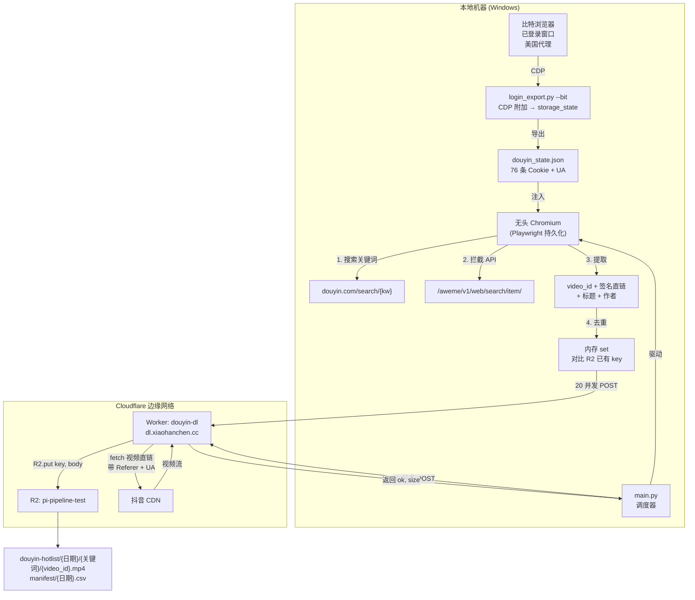

# 抖音热榜视频采集管线

> 每日自动采集抖音热榜视频 — 50 个关键词 × 每词最多 200 条 — 通过 Cloudflare Worker 边缘拉流直写 R2。全程无头浏览器，零本地存储。

---

## 架构图



---

## 1. 目标

采集抖音每日热榜搜索词对应的视频文件和元数据，存储到 Cloudflare R2 供研究分析。

| 参数 | 值 |
|---|---|
| 输入 | 抖音热榜 CSV（50 个关键词） |
| 采集量 | 每个关键词最多 200 条视频 |
| 输出 | MP4 文件 + manifest CSV，存入 R2 |
| 下载方式 | Cloudflare Worker 边缘拉流 → R2（零本地带宽） |
| 并发数 | 20 个并行 Worker 请求 |
| 本地存储 | 零（全程流式，不写磁盘） |

**规模**：50 词 × 200 条 = 每天最多 10,000 条视频。按平均 10MB 计，约 100GB/天。R2 存储费约 $0.015/GB/月，出口流量免费。

---

## 2. 技术栈

| 层 | 技术 | 职责 |
|---|---|---|
| **登录态生产** | 比特浏览器（Windows 本地） | 已登录窗口 + 美国代理 → CDP 附加 → 导出 `storage_state`（Cookie + UA） |
| **无头抓取** | Playwright + Chromium（headless） | 搜索页导航 → API 响应拦截 → 提取 video_id + 签名直链 + 标题 |
| **下载层** | Cloudflare Worker（`douyin-dl`） | 接收 POST `{url, key}` → 边缘 `fetch(视频直链)` 带 Referer → `R2.put` |
| **存储** | Cloudflare R2（`pi-pipeline-test`） | 8MB 分片流式写入，不碰本地磁盘 |
| **去重** | R2 `list_objects_v2` 批量 | 启动时一次性列出全部 key → 内存 set 查找，O(1) |
| **调度** | Python `main.py` | 读 CSV → 逐词抓取 → `ThreadPoolExecutor(20)` → POST Worker → 上传 manifest |

### 备选方案（代码已内置，未启用）

| 备选 | 切换命令 | 说明 |
|---|---|---|
| Steel.dev 云端浏览器 | `--provider steel` | 需在 `.env` 填 `STEEL_API_KEY`，云端无头，不需要本地浏览器 |
| 本地 boto3 流式上传 | 把 `worker_download` 换成 `download_to_r2` | 通过本地机器下载，占用本地带宽。Worker 挂了时的兜底方案 |
| 比特浏览器日常抓取 | 未实现 | 仅用于登录态生产。日常抓取需要 Windows + 可见窗口 |

---

## 3. 项目结构

```
douyin-hotlist/
├── .env                                 # R2 密钥 + 比特浏览器窗口 ID + Worker URL
├── config.py                            # 统一配置读取
├── login_export.py                      # 比特浏览器 CDP → douyin_state.json（一次性）
├── scraper.py                           # 无头 Chromium：搜索 → API 拦截 → 提取直链
├── downloader.py                        # R2 上传 + Worker 边缘下载
├── main.py                              # 调度入口：CSV → 抓取 → 20 并发下载 → manifest
├── douyin_state.json                    # 导出的 Cookie + UA（chmod 600，不进 git）
├── chrome_profile/                      # Playwright 持久化 profile
├── requirements.txt                     # playwright, boto3, requests
└── worker/                              # Cloudflare Worker 源码
    ├── wrangler.toml                    # R2 绑定 + 自定义域名
    └── src/index.js                     # POST 处理：fetch → R2.put
```

---

## 4. Cloudflare Worker

### 源码（`worker/src/index.js`）

```javascript
export default {
  async fetch(request, env) {
    if (request.method !== "POST") return new Response("POST only", { status: 405 });
    const { url, key, referer = "https://www.douyin.com/", ua } = await request.json();
    if (!url || !key) return Response.json({ error: "url and key required" }, { status: 400 });
    try {
      const resp = await fetch(url, {
        headers: { "User-Agent": ua, "Referer": referer },
      });
      if (!resp.ok) return Response.json({ error: `fetch failed: ${resp.status}` }, { status: 502 });
      const size = parseInt(resp.headers.get("Content-Length") || "0", 10);
      await env.R2.put(key, resp.body, { httpMetadata: { contentType: "video/mp4" } });
      return Response.json({ ok: true, key, size });
    } catch (e) {
      return Response.json({ error: e.message, key }, { status: 500 });
    }
  },
};
```

### 配置（`worker/wrangler.toml`）

```toml
name = "douyin-dl"
main = "src/index.js"
compatibility_date = "2026-10-01"

routes = [
  { pattern = "dl.xiaohanchen.cc", custom_domain = true }
]

[[r2_buckets]]
binding = "R2"
bucket_name = "pi-pipeline-test"
```

### 部署

```bash
cd worker/
npx wrangler deploy
```

### 注意：Cloudflare Zero Trust Access 拦截

如果 Worker 返回的是 Cloudflare Access 登录页而不是 JSON，说明 Zero Trust 的 "All Workers" 应用在拦截。解决：打开 https://one.dash.cloudflare.com → Access → Applications → 删除 "All Workers" 应用。删除后自定义域名（`dl.xiaohanchen.cc`）立即可用。

---

## 5. Cookie 流程

### 导出（一次性，本地）

```bash
python login_export.py --bit
```

通过 CDP 附加到比特浏览器窗口，调用 `storage_state()` 导出：
- **76 条 Cookie**（含 `sessionid`、`ttwid` 等）
- **User-Agent**（无头运行时必须与此一致）
- **localStorage**（本次为空 — Cookie 足够）

输出：`douyin_state.json`

### 注入（每次运行，无头）

```python
# scraper.py — open_context()
ctx = p.chromium.launch_persistent_context(
    PROFILE_DIR, headless=True, user_agent=ua,
    locale="zh-CN", timezone_id="Asia/Shanghai",
    args=["--disable-blink-features=AutomationControlled"],
    ignore_default_args=["--enable-automation"],
)
_seed_cookies(ctx, state)  # add_cookies + localStorage 注入
```

### 刷新

- **失效信号**：搜索页出现"扫码登录"文字 → `LoginRequired` 异常 → 脚本停止
- **恢复**：重新 `python login_export.py --bit` → 覆盖 `douyin_state.json` → 继续跑
- **有效期**：通常数周到数月

### 安全

- `douyin_state.json` 包含账号凭证 → `chmod 600`，不进 git，不外传

---

## 6. 抖音搜索 API 结构

搜索 API 端点 `https://www.douyin.com/aweme/v1/web/search/item/` 返回两种格式：

**第一页（cursor=0）** — `aweme_list` 为 null，首页无视频数据：

```json
{
  "status_code": 0,
  "aweme_list": null,
  "has_more": 1,
  "cursor": 20
}
```

**后续页（cursor ≥ 20）** — 视频数据在 `data[].aweme_info`：

```json
{
  "status_code": 0,
  "aweme_list": null,
  "data": [
    {
      "type": 1,
      "aweme_info": {
        "aweme_id": "7694646195386815163",
        "desc": "#NBA 火箭VS独行侠中国赛 场边众星云集",
        "author": { "nickname": "..." },
        "video": {
          "play_addr": {
            "url_list": ["https://v.douyin.com/..."]
          }
        }
      }
    }
  ],
  "has_more": 1,
  "cursor": 30
}
```

解析函数 `_extract_awemes()` 同时处理两种格式 — 先查 `aweme_list`（旧格式），再查 `data[].aweme_info`（当前格式）。

---

## 7. 反风控措施

| # | 措施 | 状态 |
|---|---|---|
| 1 | UA 与比特浏览器窗口一致 | ✅ 已实现 |
| 2 | 时区/语言恒定（Asia/Shanghai, zh-CN） | ✅ 已实现 |
| 3 | Cookie 注入（76 条，含 sessionid） | ✅ 已实现 |
| 4 | `--disable-blink-features=AutomationControlled` | ✅ 已实现 |
| 5 | 移除 `--enable-automation` 标志 | ✅ 已实现 |
| 6 | 登录墙检测（"扫码登录"文字 → 自动停止） | ✅ 已实现 |
| 7 | 批量去重（避免逐条 HEAD 请求） | ✅ 已实现 |
| 8 | 请求间随机 sleep（5–15 秒抖动） | ⬜ 未实现 |
| 9 | 每身份绑定静态住宅代理 | ⬜ 比特窗口有代理，无头用本地 IP |
| 10 | 使用小号 | ⬜ 用户决定 |

---

## 8. R2 输出结构

```
pi-pipeline-test/
└── douyin-hotlist/
    ├── 2026-10-10/
    │   ├── NBA中国赛火箭战胜独行侠/
    │   │   ├── 7694646195386815163.mp4
    │   │   ├── 7694616254916836977.mp4
    │   │   └── ... (每词最多 200 个)
    │   ├── 青岛海牛提前三轮降级/
    │   │   └── ...
    │   └── ... (50 个关键词目录)
    └── manifest/
        └── 2026-10-10.csv
```

**manifest CSV 列**：`keyword, video_id, title, r2_key, status (ok/failed/duplicate), size_bytes`

---

## 9. 配置（`.env`）

```ini
# R2
R2_ACCOUNT_ID=2d69fa11f3c0c3928498d29e3bf76c10
R2_ACCESS_KEY_ID=<已配置>
R2_SECRET_ACCESS_KEY=<已配置>
R2_BUCKET=pi-pipeline-test
R2_PREFIX=douyin-hotlist

# 比特浏览器
BIT_API=http://127.0.0.1:54345
BIT_WINDOW_ID=<窗口ID>

# Steel（占位，未启用）
STEEL_API_KEY=

# Worker
WORKER_URL=https://dl.xiaohanchen.cc
```

---

## 10. 快速开始

```bash
# 安装依赖（一次性）
cd douyin-hotlist/
pip install -r requirements.txt
playwright install chromium

# 从比特浏览器导出登录态（一次性）
python login_export.py --bit

# 测试：1 个关键词 × 5 条
python main.py --keywords "NBA中国赛火箭战胜独行侠" --max 5

# 全量：末尾 50 个关键词 × 200 条，20 并发 Worker 下载
python main.py --csv "热榜_2026-10-09.csv" --n 50 --max 200 --workers 20
```

---

## 11. 关键设计决策

| 决策 | 原因 |
|---|---|
| 用 Playwright 而非 Scrapling | Playwright 的 `page.on("response")` 能实时拦截 API 响应；Scrapling 的 `DynamicFetcher.fetch` 是一次性快照，不适合滚动 + 拦截 |
| 解析 API JSON 而非 CSS 选择器 | 抖音搜索 API 返回结构化 JSON（`data[].aweme_info`），比解析 DOM class 名更稳定（class 经常变） |
| 用 Cloudflare Worker 而非本地 boto3 | Worker 在边缘拉视频直写 R2，零本地带宽，20 并发无瓶颈 |
| 用 R2 `list_objects_v2` 而非 sqlite | 更简单：启动时一次 API 调用，内存 set 查找，不用维护数据库 |
| `[-n:]` 取末尾关键词 | 用户需求：从热度最低的开始跑 |

---

## 12. 路线图

- [x] **v1** — 本地验证：1 词 × 5 条 → R2 上传成功
- [x] **v2** — API 响应拦截：`data[].aweme_info` 解析 → 174/182 上传成功，0 失败
- [x] **v3** — Cloudflare Worker 边缘下载：20 并发，零本地带宽
- [x] **v4** — 批量 R2 去重 + manifest CSV 回传
- [ ] **v5** — 全量 50 词 × 200 条（进行中）
- [ ] **v6** — SSH 服务器部署 + cron 定时 + 登录态过期告警
- [ ] **v7** — 身份池（多比特窗口 + 静态住宅代理）
- [ ] **v8** — Steel.dev 接管公开页抓取，扩展到其他平台
