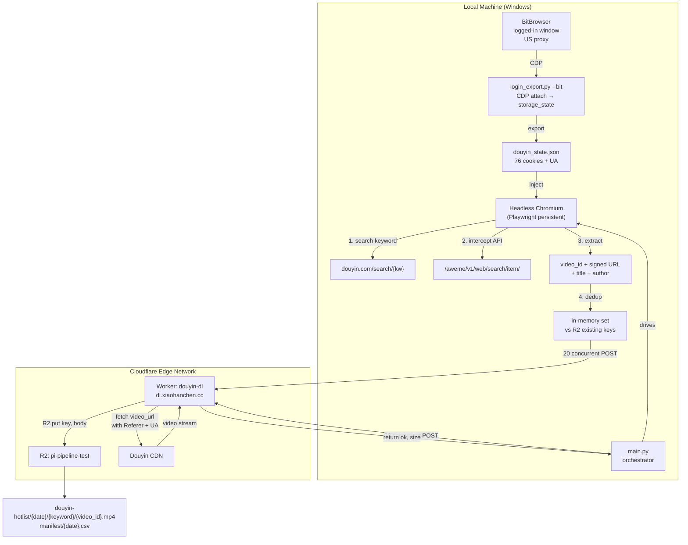

# Douyin Hotlist Video Pipeline

> Automated daily collection of Douyin trending videos — 50 keywords × up to 200 videos each — streamed directly to Cloudflare R2 via edge workers. Fully headless, zero local storage.

---

## Architecture



---

## 1. Objective

Collect video files and metadata for Douyin's daily trending search terms and store them in Cloudflare R2 for research analysis.

| Parameter | Value |
|---|---|
| Input | Douyin hotlist CSV (50 keywords) |
| Collection | Up to 200 videos per keyword |
| Output | MP4 files + manifest CSV in R2 |
| Download method | Cloudflare Worker edge fetch → R2 (zero local bandwidth) |
| Concurrency | 20 parallel Worker requests |
| Local storage | Zero (all streaming, nothing written to disk) |

**Scale**: 50 keywords × 200 videos = up to 10,000 videos/day. At ~10MB average, that's ~100GB/day. R2 storage cost: ~$0.015/GB/month. Egress: free.

---

## 2. Technology Stack

| Layer | Technology | Role |
|---|---|---|
| **Login state production** | BitBrowser (Windows, local) | Pre-logged-in browser window with US proxy → CDP attach → export `storage_state` (cookies + User-Agent) |
| **Headless scraping** | Playwright + Chromium (headless) | Search page navigation → API response interception → extract video_id + signed CDN URL + title |
| **Download layer** | Cloudflare Worker (`douyin-dl`) | Receives POST `{url, key}` → edge `fetch(video_url)` with Referer → `R2.put(key, body)` |
| **Storage** | Cloudflare R2 (`pi-pipeline-test`) | 8MB multipart streaming write, no local disk touch |
| **Deduplication** | R2 `list_objects_v2` batch | One-time list at startup → in-memory set lookup, O(1) per video |
| **Orchestration** | Python `main.py` | Read CSV → scrape per keyword → `ThreadPoolExecutor(20)` → POST Worker → upload manifest |

### Alternative providers (code-ready, not active)

| Alternative | Switch command | Notes |
|---|---|---|
| Steel.dev cloud browser | `--provider steel` | Requires `STEEL_API_KEY` in `.env`. Cloud-based headless, no local browser needed. |
| Local boto3 streaming | Replace `worker_download` with `download_to_r2` | Downloads through local machine, uses local bandwidth. Fallback if Worker is down. |
| BitBrowser for daily scraping | Not implemented | Only used for login state production. Would require Windows + visible window. |

---

## 3. Project Structure

```
douyin-hotlist/
├── .env                                 # R2 credentials, BitBrowser window ID, Worker URL
├── config.py                            # Unified config loader
├── login_export.py                      # BitBrowser CDP → douyin_state.json (one-time)
├── scraper.py                           # Headless Chromium: search → API intercept → extract URLs
├── downloader.py                        # R2 upload + Worker edge download
├── main.py                              # Orchestrator: CSV → scrape → 20-concurrent Worker → manifest
├── douyin_state.json                    # Exported cookies + UA (chmod 600, never commit)
├── chrome_profile/                      # Playwright persistent profile
├── requirements.txt                     # playwright, boto3, requests
└── worker/                              # Cloudflare Worker source
    ├── wrangler.toml                    # R2 binding + custom domain
    └── src/index.js                     # POST handler: fetch → R2.put
```

---

## 4. Cloudflare Worker

### Source (`worker/src/index.js`)

```javascript
export default {
  async fetch(request, env) {
    if (request.method !== "POST") return new Response("POST only", { status: 405 });
    const { url, key, referer = "https://www.douyin.com/", ua } = await request.json();
    if (!url || !key) return Response.json({ error: "url and key required" }, { status: 400 });
    try {
      const resp = await fetch(url, {
        headers: { "User-Agent": ua, "Referer": referer },
      });
      if (!resp.ok) return Response.json({ error: `fetch failed: ${resp.status}` }, { status: 502 });
      const size = parseInt(resp.headers.get("Content-Length") || "0", 10);
      await env.R2.put(key, resp.body, { httpMetadata: { contentType: "video/mp4" } });
      return Response.json({ ok: true, key, size });
    } catch (e) {
      return Response.json({ error: e.message, key }, { status: 500 });
    }
  },
};
```

### Configuration (`worker/wrangler.toml`)

```toml
name = "douyin-dl"
main = "src/index.js"
compatibility_date = "2026-10-01"

routes = [
  { pattern = "dl.xiaohanchen.cc", custom_domain = true }
]

[[r2_buckets]]
binding = "R2"
bucket_name = "pi-pipeline-test"
```

### Deployment

```bash
cd worker/
npx wrangler deploy
```

### Note: Cloudflare Zero Trust Access

If the Worker returns a Cloudflare Access login page instead of JSON, it means Zero Trust's "All Workers" application is intercepting requests. Fix: go to https://one.dash.cloudflare.com → Access → Applications → delete the "All Workers" application. Custom domain (`dl.xiaohanchen.cc`) will then work directly.

---

## 5. Cookie Flow

### Export (one-time, local)

```bash
python login_export.py --bit
```

Attaches to the BitBrowser window via CDP, calls `storage_state()` to export:
- **76 cookies** (including `sessionid`, `ttwid`, etc.)
- **User-Agent** string (must match when running headless)
- **localStorage** (empty in this case — cookies alone are sufficient)

Output: `douyin_state.json`

### Injection (each run, headless)

```python
# scraper.py — open_context()
ctx = p.chromium.launch_persistent_context(
    PROFILE_DIR, headless=True, user_agent=ua,
    locale="zh-CN", timezone_id="Asia/Shanghai",
    args=["--disable-blink-features=AutomationControlled"],
    ignore_default_args=["--enable-automation"],
)
_seed_cookies(ctx, state)  # add_cookies + localStorage injection
```

### Refresh

- **Failure signal**: search page shows "扫码登录" (QR login) → `LoginRequired` exception → script stops
- **Recovery**: run `python login_export.py --bit` again → overwrite `douyin_state.json` → resume
- **Typical lifetime**: weeks to months

### Security

- `douyin_state.json` contains account credentials → `chmod 600`, never commit to git, never share

---

## 6. Douyin Search API Structure

The search API endpoint `https://www.douyin.com/aweme/v1/web/search/item/` returns two response formats:

**First page (cursor=0)** — `aweme_list` is null, no video data in the first response:

```json
{
  "status_code": 0,
  "aweme_list": null,
  "has_more": 1,
  "cursor": 20
}
```

**Subsequent pages (cursor ≥ 20)** — video data is in `data[].aweme_info`:

```json
{
  "status_code": 0,
  "aweme_list": null,
  "data": [
    {
      "type": 1,
      "aweme_info": {
        "aweme_id": "7694646195386815163",
        "desc": "#NBA 火箭VS独行侠中国赛 场边众星云集",
        "author": { "nickname": "..." },
        "video": {
          "play_addr": {
            "url_list": ["https://v.douyin.com/..."]
          }
        }
      }
    }
  ],
  "has_more": 1,
  "cursor": 30
}
```

The scraper's `_extract_awemes()` function handles both formats — checking `aweme_list` first (legacy), then `data[].aweme_info` (current).

---

## 7. Anti-Detection Measures

| # | Measure | Status |
|---|---|---|
| 1 | User-Agent matches BitBrowser window | ✅ Implemented |
| 2 | Timezone/locale fixed (Asia/Shanghai, zh-CN) | ✅ Implemented |
| 3 | Cookie injection (76 cookies including sessionid) | ✅ Implemented |
| 4 | `--disable-blink-features=AutomationControlled` | ✅ Implemented |
| 5 | `--enable-automation` flag removed | ✅ Implemented |
| 6 | Login wall detection ("扫码登录" text → auto-stop) | ✅ Implemented |
| 7 | Batch deduplication (avoid per-video HEAD requests) | ✅ Implemented |
| 8 | Random sleep between requests (5–15s jitter) | ⬜ Not yet |
| 9 | Static residential proxy per identity | ⬜ BitBrowser has proxy, headless uses local IP |
| 10 | Use burnable accounts only | ⬜ User decision |

---

## 8. R2 Output Structure

```
pi-pipeline-test/
└── douyin-hotlist/
    ├── 2026-10-10/
    │   ├── NBA中国赛火箭战胜独行侠/
    │   │   ├── 7694646195386815163.mp4
    │   │   ├── 7694616254916836977.mp4
    │   │   └── ... (up to 200 per keyword)
    │   ├── 青岛海牛提前三轮降级/
    │   │   └── ...
    │   └── ... (50 keyword directories)
    └── manifest/
        └── 2026-10-10.csv
```

**Manifest CSV columns**: `keyword, video_id, title, r2_key, status (ok/failed/duplicate), size_bytes`

---

## 9. Configuration (`.env`)

```ini
# R2
R2_ACCOUNT_ID=2d69fa11f3c0c3928498d29e3bf76c10
R2_ACCESS_KEY_ID=<configured>
R2_SECRET_ACCESS_KEY=<configured>
R2_BUCKET=pi-pipeline-test
R2_PREFIX=douyin-hotlist

# BitBrowser
BIT_API=http://127.0.0.1:54345
BIT_WINDOW_ID=<window-id>

# Steel (placeholder, not active)
STEEL_API_KEY=

# Worker
WORKER_URL=https://dl.xiaohanchen.cc
```

---

## 10. Quick Start

```bash
# Install dependencies (one-time)
cd douyin-hotlist/
pip install -r requirements.txt
playwright install chromium

# Export login state from BitBrowser (one-time)
python login_export.py --bit

# Test with 1 keyword × 5 videos
python main.py --keywords "NBA中国赛火箭战胜独行侠" --max 5

# Full run: last 50 keywords × 200 videos, 20 concurrent Worker downloads
python main.py --csv "hotlist_2026-10-09.csv" --n 50 --max 200 --workers 20
```

---

## 11. Key Design Decisions

| Decision | Rationale |
|---|---|
| Playwright over Scrapling | Playwright's `page.on("response")` intercepts API responses in real-time; Scrapling's `DynamicFetcher.fetch` is a one-shot snapshot, less suited for scroll-and-intercept |
| API JSON parsing over CSS selectors | Douyin's search API returns structured JSON (`data[].aweme_info`) — more stable than parsing DOM with class names that change frequently |
| Cloudflare Worker over local boto3 | Worker fetches video at edge → writes directly to R2; zero local bandwidth, 20 concurrent with no bottleneck |
| R2 `list_objects_v2` over sqlite | Simpler: one API call at startup, in-memory set lookup; no database to maintain |
| `[-n:]` keyword selection | User requirement: start from the bottom of the trending list (lower-ranked keywords first) |

---

## 12. Roadmap

- [x] **v1** — Local validation: 1 keyword × 5 videos → R2 upload confirmed
- [x] **v2** — API response interception: `data[].aweme_info` parsing → 174/182 uploaded, 0 failures
- [x] **v3** — Cloudflare Worker edge download: 20 concurrent, zero local bandwidth
- [x] **v4** — Batch R2 deduplication + manifest CSV upload
- [ ] **v5** — Full 50 keywords × 200 videos run (in progress)
- [ ] **v6** — SSH server deployment + cron scheduling + login expiry alerts
- [ ] **v7** — Identity pool (multiple BitBrowser windows + residential proxies)
- [ ] **v8** — Steel.dev for public page scraping, expand to other platforms
