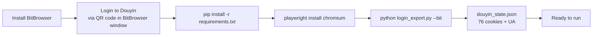
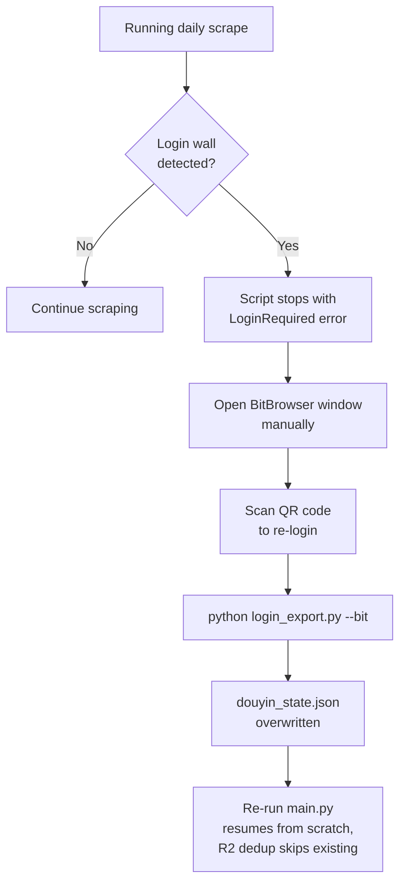
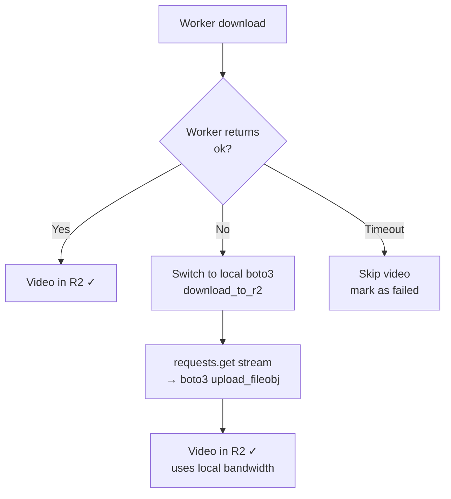
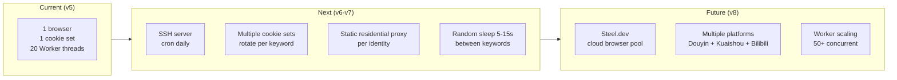

# Douyin Hotlist Pipeline — Workflow

> Step-by-step operational workflow for daily video collection. Separate from the architecture doc — this is the runbook.

---

## Workflow Overview

```mermaid
flowchart TD
    START([Daily Run]) --> READ[Read hotlist CSV]
    READ --> PICK[Pick last 50 keywords]
    PICK --> LIST[List existing R2 keys<br/>one batch call]
    LIST --> LAUNCH[Launch headless Chromium<br/>inject 76 cookies]
    LAUNCH --> WARM[Warm up douyin.com homepage]
    WARM --> LOOP{For each keyword}
    
    LOOP --> SEARCH[Navigate to search URL]
    SEARCH --> INTERCEPT[Intercept API response<br/>/aweme/v1/web/search/item/]
    INTERCEPT --> PARSE[Parse data&#91;&#93;.aweme_info<br/>extract video_id + play_url + title]
    PARSE --> SCROLL[Scroll to load more<br/>0.5s × 2 per round]
    SCROLL --> GROW{New videos<br/>found?}
    GROW -->|Yes| INTERCEPT
    GROW -->|No, 4 rounds| DEDUP
    
    LOOP --> DEDUP[Deduplicate by video_id<br/>cross-ref R2 existing keys]
    DEDUP --> NEW{New videos?}
    NEW -->|Yes| POST[POST 20 concurrent<br/>to Worker dl.xiaohanchen.cc]
    NEW -->|No| NEXT
    
    POST --> WORKER[Worker: fetch video_url<br/>with Referer + UA]
    WORKER --> PUT[R2.put key, body<br/>8MB streaming]
    PUT --> RESULT[Collect ok/failed results]
    RESULT --> NEXT[Next keyword]
    
    NEXT --> LOOP
    LOOP -->|All done| MANIFEST[Write manifest CSV]
    MANIFEST --> UPLOAD[Upload manifest to R2]
    UPLOAD --> DONE([Complete])
    
    GROW -->|Login wall detected| STOP[Stop + alert]
    STOP --> RELOGIN[Re-run login_export.py --bit]
    RELOGIN --> RESUME[Resume from last keyword]
```



---

## 1. One-Time Setup



| Step | Command | Notes |
|---|---|---|
| Install dependencies | `pip install -r requirements.txt` | playwright, boto3, requests |
| Install browser | `playwright install chromium` | Downloads Chromium for Playwright |
| Export cookies | `python login_export.py --bit` | Attaches to BitBrowser via CDP, exports `storage_state` |
| Verify | `python main.py --keywords "test" --max 5` | Should parse 5, upload 5, 0 failures |

---

## 2. Daily Run

### 2a. Full Run

```bash
python main.py \
  --csv "hotlist_2026-10-09.csv" \
  --n 50 \
  --max 200 \
  --workers 20
```

| Flag | Meaning |
|---|---|
| `--csv` | Path to Douyin hotlist CSV file |
| `--n 50` | Take last 50 keywords (lowest-ranked first) |
| `--max 200` | Max 200 videos per keyword |
| `--workers 20` | 20 concurrent Worker download threads |

### 2b. What Happens at Each Stage

| Stage | Action | Duration |
|---|---|---|
| **Read CSV** | Parse hotlist, extract keywords from `关键词` column | < 1s |
| **List R2** | `list_objects_v2` — one batch call for all existing keys under `douyin-hotlist/{date}/` | 1–3s |
| **Launch browser** | Headless Chromium + persistent profile + 76 cookies injected | 3–5s |
| **Warm up** | Navigate to `douyin.com` homepage to establish session | 2–3s |
| **Scrape (per keyword)** | Navigate to search URL → intercept API → parse `data[].aweme_info` → scroll → dedup | 10–30s/keyword |
| **Download (per keyword)** | 20 concurrent POST to Worker → Worker fetches video → R2.put | 1–5 min/keyword (depends on video count) |
| **Manifest** | Write CSV, upload to R2 | < 5s |

**Total estimated time**: 50 keywords × ~3 min average = ~2.5 hours

### 2c. Console Output Format

```
[*] 列出 R2 已有文件...
[*] 已有 9 个文件
[*] local | 50 词 × ≤200 条 | 20 并发 Worker
[*] 抓取: NBA中国赛火箭战胜独行侠
    解析 182 条 → Worker 下载...
[+] NBA中国赛火箭战胜独行侠: 解析 182 | 上传 174 | 重复 8 | 失败 0
[*] 抓取: 青岛海牛提前三轮降级
    解析 159 条 → Worker 下载...
[+] 青岛海牛提前三轮降级: 解析 159 | 上传 155 | 重复 4 | 失败 0
...
[ok] manifest -> s3://pi-pipeline-test/douyin-hotlist/manifest/2026-10-10.csv
```

---

## 3. Cookie Refresh Workflow



| Step | Action |
|---|---|
| Detection | Scraper checks page content for "扫码登录" text |
| Stop | `LoginRequired` exception → script terminates gracefully |
| Re-login | Open BitBrowser window → scan QR code in Douyin |
| Re-export | `python login_export.py --bit` → overwrites `douyin_state.json` |
| Resume | Re-run `main.py` — R2 deduplication skips already-downloaded videos |

---

## 4. Worker Download Flow

```mermaid
sequence diagram
    participant Main as main.py
    participant Pool as ThreadPoolExecutor(20)
    participant Worker as Cloudflare Worker
    participant CDN as Douyin CDN
    participant R2 as R2

    Main->>Pool: submit({url, key, ua, referer})
    
    par 20 concurrent
        Pool->>Worker: POST {url, key, ua, referer}
        Worker->>CDN: fetch(video_url, {Referer, UA})
        CDN-->>Worker: video stream (200 OK)
        Worker->>R2: R2.put(key, body)
        R2-->>Worker: success
        Worker-->>Pool: {ok: true, key, size}
    end
    
    Pool-->>Main: all results collected
    Main->>Main: aggregate ok/failed/duplicate
```

---

## 5. Deduplication Flow

```mermaid
flowchart LR
    A[Startup] --> B[list_objects_v2<br/>R2 prefix=douyin-hotlist/{date}/]
    B --> C[Build existing_keys set<br/>in memory]
    C --> D[During scraping]
    D --> E{video_id in<br/>existing_keys?}
    E -->|Yes| SKIP[Skip<br/>count as duplicate]
    E -->|No| POST[POST to Worker]
    POST --> F[After upload<br/>add to existing_keys]
    F --> NEXT[Next video]
```

- **One batch call** at startup: `list_objects_v2(Prefix=f"douyin-hotlist/{date}/")`
- **In-memory set**: O(1) lookup per video
- **Cross-keyword dedup**: same video appearing under multiple keywords → only downloaded once
- **Re-run safety**: if script crashes mid-run, re-running skips all already-uploaded videos

---

## 6. Failure Handling

| Failure | Detection | Recovery |
|---|---|---|
| Login wall | Page contains "扫码登录" | `LoginRequired` → stop → re-export cookies → re-run |
| Worker timeout | POST request times out (120s) | Skip video → mark as `failed` in manifest |
| Worker fetch 403 | Worker returns `{error: "fetch failed: 403"}` | Referer/UA missing → check `.env` config |
| R2 put error | Worker returns `{error: "..."}` | Retry once → mark as `failed` |
| Scraper parses 0 videos | `解析 0 条` in console | API format changed → check `_extract_awemes()` |
| Network error | `requests.ConnectionError` | Retry 3 times with backoff |

---

## 7. Output Verification

After a run completes, verify results:

```bash
# Check manifest in R2
rclone cat r2:pi-pipeline-test/douyin-hotlist/manifest/2026-10-10.csv | head -20

# Count videos per keyword
rclone cat r2:pi-pipeline-test/douyin-hotlist/manifest/2026-10-10.csv | \
  python -c "import sys,csv; [print(r[0], r[4]) for r in csv.reader(sys.stdin)]" | \
  sort | uniq -c

# List R2 directory tree
rclone tree r2:pi-pipeline-test/douyin-hotlist/2026-10-10/ --max-depth 1
```

**Manifest columns**: `keyword, video_id, title, r2_key, status, size_bytes`

| Status | Meaning |
|---|---|
| `ok` | Video uploaded to R2 successfully |
| `failed` | Download or upload failed |
| `duplicate` | Video already exists in R2 (skipped) |

---

## 8. Worker Fallback

If the Cloudflare Worker is down or returning errors:



To switch manually:
```python
# In main.py, change:
results = worker_download_batch(videos, ...)
# To:
results = local_download_batch(videos, ...)
```

---

## 9. Scaling Up



| Phase | What changes | Key work |
|---|---|---|
| v6 (SSH deploy) | Move from local Windows to Linux server | Headless Chromium + cron + alert on login expiry |
| v7 (Identity pool) | Multiple BitBrowser windows with different proxies | Round-robin keywords across identities |
| v8 (Scale out) | Steel.dev for cloud browser, expand platforms | `--provider steel` already works, just add API key |
